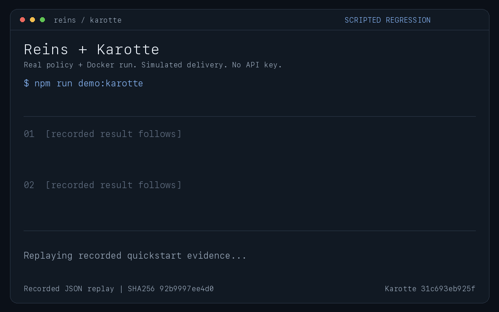

<div align="center">
  
  <h1>🪢 Reins</h1>
  <p><strong>Security controls for AI agents.</strong></p>

  <p>
    <a href="https://github.com/pegasi-ai/reins">github.com/pegasi-ai/reins</a>
  </p>

  <p>
    <a href="https://www.npmjs.com/package/clawreins"></a>
    <a href="https://www.npmjs.com/package/clawreins"></a>
    <a href="https://www.apache.org/licenses/LICENSE-2.0"></a>
    <a href="http://www.typescriptlang.org/"></a>
    = 18.0.0">
  </p>
</div>

> In Greek myth, Athena gave Bellerophon the golden bridle — reins included — that let him guide Pegasus. Reins applies the same idea to AI agents: raw power is not enough — what matters is making it controllable.

Reins checks agent tool calls against configurable security policies, scans agent configs, and tracks configuration drift. Integrations include Claude Code hooks and OpenClaw. Custom tool adapters can call the policy engine directly.

## Quickstart

```bash
npm install -g @pegasi-ai/reins
reins init
```

### Try a policy check without an agent or API key

From a clone of this repository, using Node.js 22.12 or newer:

```bash
npm ci --ignore-scripts
npm run demo:karotte:policy
```

Watch Reins deny an outside recipient, allow the authorized team, and verify the saved simulated delivery. To run the same scenario through a real RL environment, install uv, start Docker, and run `npm run demo:karotte`.

### Reins + Karotte

Reins controls a scoped publishing tool; [Karotte](https://github.com/preferencemodel/karotte) runs the task and grades its protected delivery record. The keyless replay verifies both an enforced denial and authorized completion.



This GIF presents a recorded scripted regression. Delivery is simulated; no real email is sent. See the [quickstart, implementation, and boundaries](./examples/karotte/README.md).

## Claude Code Skill

Install the Reins skill to give Claude Code awareness of your security posture:

```bash
mkdir -p ~/.claude/skills/reins
curl -o ~/.claude/skills/reins/SKILL.md \
  https://raw.githubusercontent.com/pegasi-ai/reins/main/.claude/skills/reins/SKILL.md
```

Or clone the repo — the skill is included at `.claude/skills/reins/` automatically.

## Demo


An OpenClaw agent tries to bulk-delete 4,382 Gmail messages. Reins blocks it before execution.

## What Reins does

- **Prevent** — Block destructive actions before execution. Score irreversibility. Detect risky browser state.
- **Pause** — Route high-impact actions through terminal or messaging approval flows. Require explicit `CONFIRM-*` tokens for catastrophic operations.
- **Record** - Keep local decision records for inspection and debugging.

## Security scope

Controls apply to actions routed through a configured integration. Review each adapter's error handling, tool coverage, policy defaults, and approval behavior before relying on it. An alternate tool or unrestricted shell can bypass a scoped adapter.

When a rule has non-empty `allowPaths` or `denyPaths`, the adapter must supply a non-empty string target. Missing or invalid targets are denied. Network and browser calls use `url` or `src`; file calls use `path`, `file_path`, or `target`.

Local JSONL records are editable by users with filesystem access. Logging alone does not prove execution or evidence completeness. The Karotte example separately records policy decisions and simulated deliveries in protected task state, then checks both during grading.

### Channel approval ownership and migration

A channel approval belongs to one waiting invocation. Concurrent calls, including identical calls, receive separate tokens and require separate approvals. A retry creates a new request; it cannot consume a previous approval. Denial, notification failure, and the two-minute deadline invalidate only that request. The deadline includes notification delivery. Tokens are generated internally; `intervention.confirmationToken` remains supported for TTY prompts but is ignored in channel mode.

Custom trusted notifiers must use the fourth `onBlockCallback` argument to look up the exact pending request:

```ts
interceptor.onBlockCallback = async (session, module, method, request) => {
  const info = approvalQueue.getNotificationInfo(request.handle);
  if (!info) return false;
  return sendToHuman(session, info.summary || `${module}.${method}()`, info.token);
};
```

`sendToHuman` is your trusted channel adapter and returns whether the notification was sent. Keep the request handle and token outside agent-visible messages. The bundled plugin supplies this adapter. Legacy queue calls that created unbound approvals or looked them up by session/module/method must migrate to handles; `consume` is removed. Three-argument callback functions remain callable, but slot-based token lookup is no longer supported.

Channel ASK arguments must be plain JSON data, at most 64 levels deep and 1 MiB when serialized, including the outer argument array. Unsupported values, getters, proxies, cycles, sparse arrays, and custom object types are rejected. Object keys are canonicalized; array order and literal values remain significant. Reins keeps a detached immutable snapshot and checks the original arguments and current in-memory policy after approval and logging. Changes invalidate the approval. ALLOW, DENY, and TTY flows retain their existing argument contract.

Notifications retain the existing summary display. Binding a notification to an invocation does not mean the human reviewed every parameter. The host must execute the checked arguments after `evaluate` succeeds; Reins does not prevent caller mutation after it returns, perform the effect, or automatically reload policy from disk.

The [approval ownership audit](scripts/approval-audit/README.md) provides a reproducible 5,670-trace check of two concurrent requests against an independent queue model. Integration regressions run with `npm test`.

## Documentation

Full docs at [reins.sh/docs](https://reins.sh/docs):

- [Getting Started](https://reins.sh/docs/getting-started)
- [How It Works](https://reins.sh/docs/how-it-works)
- [Security Policies](https://reins.sh/docs/policies)
- [CLI Reference](https://reins.sh/docs/cli)
- [Security Scan](https://reins.sh/docs/scan)
- [Reins Cloud](https://reins.sh/docs/reins-cloud)
- [Use as a Library](https://reins.sh/docs/library)
- [Architecture](https://reins.sh/docs/architecture)

## Contributing

PRs welcome. See [CONTRIBUTING.md](CONTRIBUTING.md).

## License

Apache 2.0 — see [LICENSE](LICENSE).
